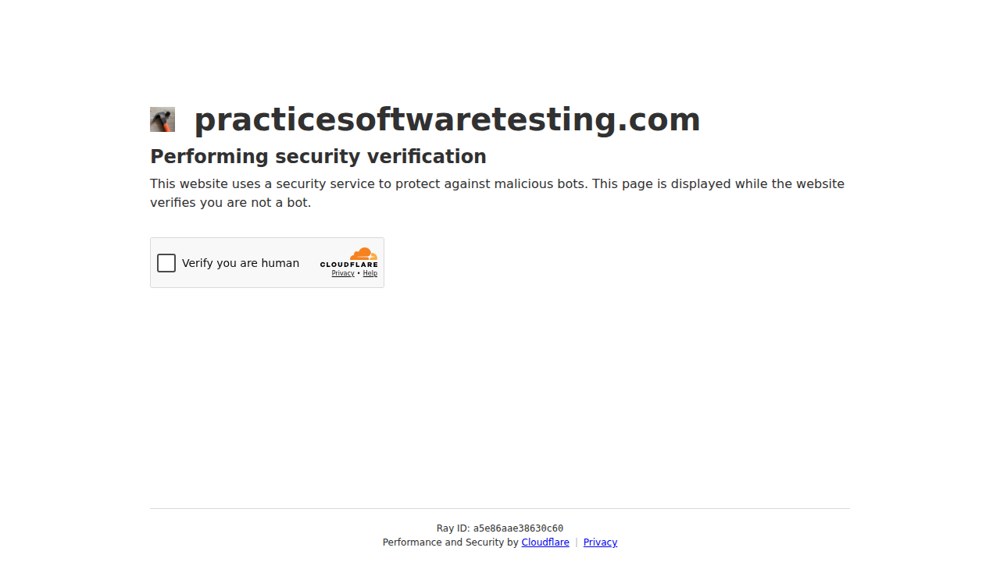
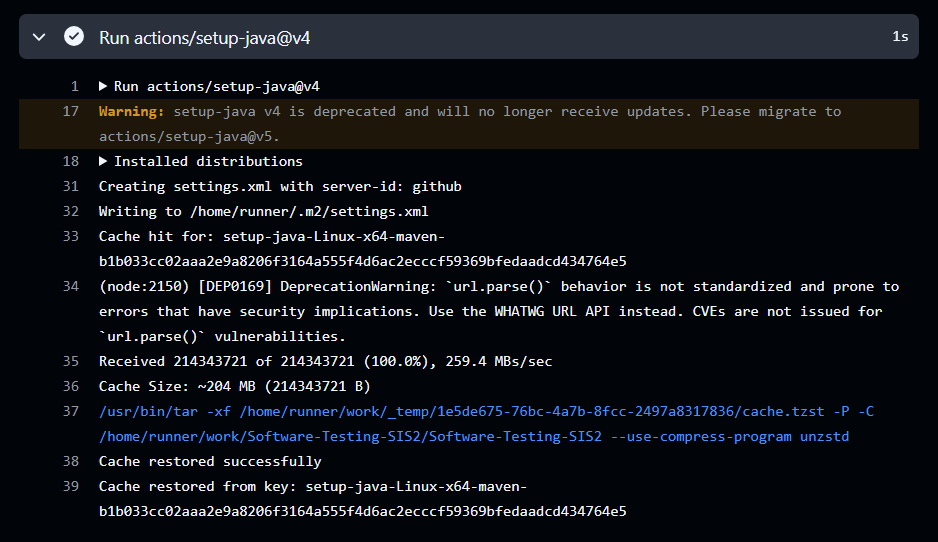
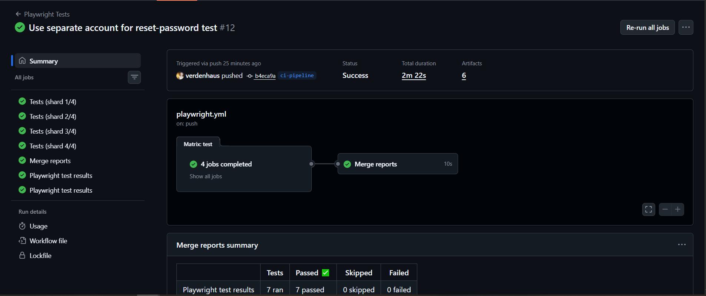
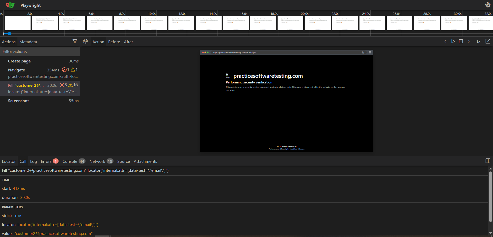

# Software Testing: Playwright (Java + JUnit 5)

End-to-end tests for the [Practice Software Testing](https://practicesoftwaretesting.com) toolshop, written with Playwright for Java and JUnit 5.
The test cases are described in [Description.md](Description.md). AI usage is in [Prompt.md](Prompt.md) and [Review.md](Review.md) (SIS 2) and in [AI_CI.md](AI_CI.md) (CI pipeline).

## CI

**CI system:** GitHub Actions. It is built into GitHub, where the repository already lives, needs no server of its own, is free for public repositories and supports matrices for sharding.

**Pipeline** (`.github/workflows/playwright.yml`), one `test` job per shard plus a `Merge reports` job:
- runs on every push (any branch) and every pull request, plus manual runs (`workflow_dispatch`);
- `actions/setup-java` with `cache: maven` (the Maven equivalent of `setup-node` + `cache: npm`), dependencies resolved with `mvn test-compile`, Chromium installed with its system dependencies through the Playwright CLI (`install --with-deps chromium`);
- starts its own copy of the toolshop in Docker on the runner, seeds the database and waits until the UI (`localhost:4200`) and API (`localhost:8091`) answer (see [Why the shop runs in Docker](#why-the-shop-runs-in-docker));
- runs the full suite, with no filters, split into 4 shards in parallel (`SHARD=i/4`, see below);
- the `Merge reports` job merges the shards' JUnit XML into one JUnit file and one HTML report, and publishes a test summary check (`Playwright test results`);
- artefacts: `playwright-report` (HTML), `test-results-N` (traces, failure screenshots, per-shard JUnit), `junit-report` (merged JUnit), kept for 14 days. Shards and the merge job run even when tests fail (`if: !cancelled()`, `fail-fast: false`), and the container logs are printed when a shard fails.

**CI settings** (`pom.xml`, profile `ci`, switched on automatically when the `CI` environment variable is set; GitHub Actions sets it):

The assignment guide is written for Playwright Test (TypeScript). This project uses Playwright for **Java**, which has no `playwright.config.ts`, `forbidOnly`, `--shard` or blob reporter, so each requirement is implemented with its Java/JUnit equivalent:

| Playwright Test (TS) | This project (Java / Maven / JUnit 5) |
| --- | --- |
| `forbidOnly: isCI` | `guard/NoSkippedTestsTest` runs only when `CI` is set and fails the build if any test is `@Disabled` or tagged `@Tag("only")`. JUnit has no `test.only`; in Java you "focus" on a test by disabling the others, so that is what is forbidden. |
| `retries: isCI ? 2 : 0` | `rerunFailingTestsCount=2` in the `ci` profile. A test that passes on a rerun is reported as *flaky* instead of failing the build. |
| `workers: isCI ? 2 : undefined` | JUnit parallel execution fixed at 2 threads in CI (`junit.jupiter.execution.parallel.config.fixed.parallelism=2`). |
| `junit` reporter | Surefire's JUnit XML, written to `reports/` in CI; merged into `reports/junit-merged.xml`. |
| `trace: 'on-first-retry'` | `fixtures/TestSetup` records a trace for every attempt and keeps it, plus a full-page screenshot, only when the attempt fails (`test-results/<Class>.<method>/`). With retries this includes the trace of exactly the failed first try. Green runs therefore have no traces. |
| `--shard=i/n` + `fullyParallel` | `ci/ShardFilter`, a JUnit `PostDiscoveryFilter` registered through `META-INF/services`. With `SHARD=i/n` each test **method** goes to the shard given by the hash of its unique id, so tests of one class can run on different shards. The assignment only depends on the test itself, so it stays the same in Surefire's per-class scans and in reruns. Without `SHARD` every test runs. |
| `blob` reporter + `merge-reports` | `scripts/merge_reports.py` merges the shards' XML into one JUnit file and a single HTML report with links to the traces. |
| `baseURL: process.env.BASE_URL` | `config/TestConfig` reads `BASE_URL` (set to `http://localhost:4200` in the workflow) and the login account from `CUSTOMER_EMAIL` / `CUSTOMER_PASSWORD`. Without them it uses the live site and the seeded demo account `customer2@practicesoftwaretesting.com`, so nothing is required to run locally. |

Opening a trace: download a `test-results-N` or `playwright-report` artefact from a failed run and drop the `.zip` on [trace.playwright.dev](https://trace.playwright.dev), or run
`mvn exec:java -e -Dexec.mainClass=com.microsoft.playwright.CLI -Dexec.args="show-trace path/to/trace.zip"`.

### Why the shop runs in Docker

practicesoftwaretesting.com is behind Cloudflare. Requests from GitHub's runners get a "Verify you are human" page instead of the shop, so every test timed out waiting for its first element. The failure screenshot and trace recorded by the pipeline show it:

The shop is open source ([testsmith-io/practice-software-testing](https://github.com/testsmith-io/practice-software-testing)) and publishes prebuilt Docker images. Each shard therefore:
1. clones that repository and starts it with `docker compose -f docker-compose.prod.yml up --pull missing -d`;
2. seeds a fresh database (`php artisan migrate:fresh --seed`, retried until MariaDB is ready);
3. waits until `http://localhost:8091/products` and `http://localhost:4200` return 200;
4. runs the tests with `BASE_URL=http://localhost:4200`.

A fresh database per run has another benefit: the shared demo accounts on the live site were repeatedly locked or changed by other users, while in CI every run starts with clean accounts.

### Problems found while setting up CI

- **`ubuntu-latest` is Ubuntu 26.04**, which Playwright 1.56 does not support ("Playwright does not support chromium on ubuntu26.04-x64"). The runner is pinned to `ubuntu-24.04`.
- **Cloudflare blocks GitHub runners** (see above), so the shop runs in Docker.
- **Some shop images are ARM-only.** The `web` (nginx, serves the API on port 8091) and `cron` images failed with `exec format error` on the x86 runner. `docker/setup-qemu-action` emulates arm64 so they can run.
- **"Forgot password" really changes the password.** The shop's API resets the account's password to `welcome02` without telling the user (the UI only shows `page.forgot-password.confirm`). When sharding put `ResetPasswordTest` and `BuyProductTest` in the same shard, the reset broke `BuyProductTest`'s login. `ResetPasswordTest` now uses its own account (`customer@practicesoftwaretesting.com`), which no other test logs in with. This also explains why the shared demo accounts on the live site kept breaking.
- **Sharding first ran every test in every shard.** The first `ShardFilter` remembered the test list from Surefire's first per-class scan, so tests from other classes were never filtered out. It was rewritten to decide from each test's own id.

### Evidence

| Requirement | Evidence |
| --- | --- |
| Runs on push and on pull request | [push run](https://github.com/verdenhaus/Software-Testing-SIS2/actions/runs/45035508960), [pull request run](https://github.com/verdenhaus/Software-Testing-SIS2/actions/runs/45035513520) |
| Cached dependencies | `setup-java` step log of a later run reports the Maven cache was restored:  |
| Full suite, 4 shards in parallel + merge |  |
| HTML report and traces as artefacts (14 days) | `playwright-report`, `test-results-1…4`, `junit-report` on each run page; a trace opened in trace.playwright.dev:  |
| CI-specific configuration (`forbidOnly`) | [run with a committed `@Disabled` test](https://github.com/verdenhaus/Software-Testing-SIS2/actions/runs/45038044703) fails on `NoSkippedTestsTest` |
| Status badge for `main` | Badge at the top of this README |

### Runtime

| Configuration | Total run time | Run tests step (slowest shard) | Run |
| --- | --- | --- | --- |
| 1 job, no sharding | 2 min 23 s | 20 s | [run](https://github.com/verdenhaus/Software-Testing-SIS2/actions/runs/45039080203) |
| 4 shards + merge | 2 min 22 s | 19 s | [run](https://github.com/verdenhaus/Software-Testing-SIS2/actions/runs/45040938753) |

Median of 3 runs for each configuration (the push run, the pull request run for the same commit, and one re-run):

| Configuration | Total run time | Run tests step |
| --- | --- | --- |
| 1 job | 2 min 23 s / 2 min 11 s / 2 min 28 s | 27 s / 20 s / 20 s |
| 4 shards | 2 min 43 s / 2 min 20 s / 2 min 22 s | 31 s / 19 s / 13 s |

**Conclusion:** with only 7 tests, sharding does not reduce the runtime. About 2 minutes of setup (dependencies, browser, QEMU, starting and seeding the shop) is repeated in every shard and dominates the ~20 s of test time, while 4 shards use about 4 times the runner minutes. Sharding would only pay off for a much larger suite. The 31 s outlier was the first test hitting a freshly started shop (cold start of the Angular dev server and the emulated web server).

### Running locally

Against the live site:

    mvn test-compile
    mvn exec:java -e -Dexec.mainClass=com.microsoft.playwright.CLI -Dexec.args="install --with-deps chromium"
    CI=true mvn test

One shard only, as in CI: `CI=true SHARD=1/4 mvn test`. PowerShell: `$env:CI = "true"; mvn test; Remove-Item Env:CI`.

Against a local copy of the shop, as in CI (needs Docker):

    git clone --depth 1 https://github.com/testsmith-io/practice-software-testing.git pst
    cd pst && docker compose -f docker-compose.prod.yml up --pull missing -d
    docker compose -f docker-compose.prod.yml exec -T laravel-api php artisan migrate:fresh --seed --force
    cd .. && BASE_URL=http://localhost:4200 CI=true mvn test

Merging local results into the HTML report:

    mkdir -p all-results/test-results-1 && cp -r reports test-results all-results/test-results-1/
    python3 scripts/merge_reports.py all-results reports/junit-merged.xml playwright-report
